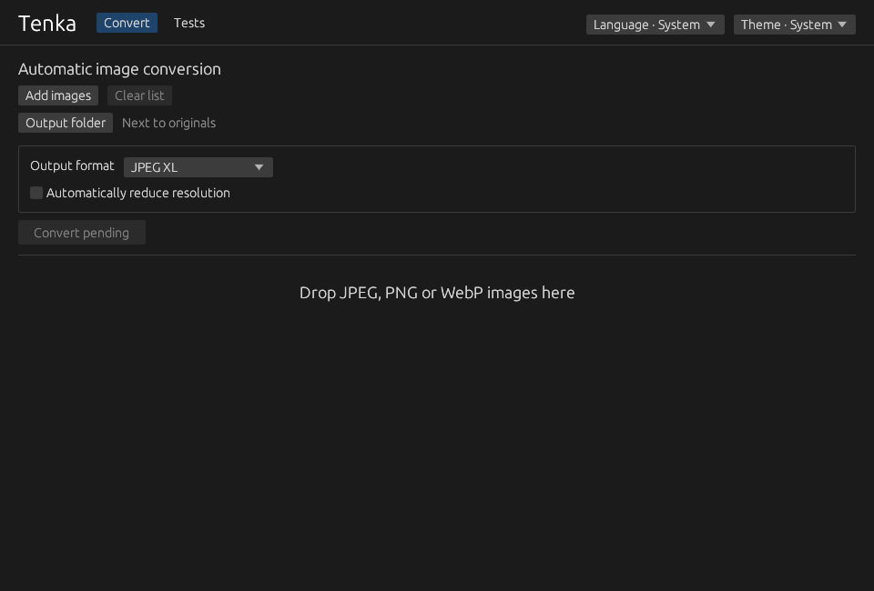

# Tenka

---

> [!NOTE]
> Tenka is under active development. Behavior may change, bugs may occur, and saved settings may become outdated.

---

Tenka is a Linux image optimizer. Its Rust engine automatically selects compression and optionally reduces resolution while keeping the saved image visually close to the original. The engine is a separate Rust library for reuse in desktop apps and container workloads.

---

## Features

- Batch conversion of still, 8-bit JPEG, PNG, and WebP images up to 36 megapixels to JPEG XL or WebP.
- Automatic compression selection and optional resolution reduction based on similarity to the original.
- Lossless encoding of prepared pixels, with source orientation applied and supported ICC profiles converted to sRGB.
- Batch tests at up to eleven quality thresholds in the selected codec, with saved results and previews.
- English and Russian interface with system, light, and dark themes.

---

<h2>Controls &amp; Shortcuts</h2>

| Input | Action |
| --- | --- |
| Drop files or select **Add images** | Add source images to the conversion queue. |
| **Output format** | Choose JPEG XL or WebP. |
| Enable **Automatically reduce resolution** | Also test smaller dimensions for visual similarity to the original. Enabled by default in **Tests**. |
| Select **Convert pending** | Save the most similar result that saves space in the selected format. Results go beside their originals or into the chosen folder. Existing files are kept. |
| Set **Quality, %** in **Tests** and select **+** | Start at 100% and add up to ten extra values, each two points below the previous one, with a minimum of 1%. At 100%, Tenka encodes losslessly at the original resolution. Below 100%, it looks for the closest result at or below the requested score, testing resizing alone and with compression when resizing is enabled. At equal displayed scores, the smaller file wins. |
| Select **Run tests and save** in **Tests** | Save each matching result in the selected format, next to the source or in the chosen folder. The file name includes the requested score, such as `photo-90.webp`. |
| Select a test result | Display it beside the source preview. |
| Select **Compare images** in **Tests** | Drop files into the comparison window or select **Add images**. **Split** is enabled by default and composes one view from corresponding regions of the images. Toggle it to show each image separately. Scroll to zoom at the pointer and drag with the left mouse button to pan together. |

Tenka saves only results that are smaller than the source and no larger than a full-resolution lossless encode in the selected format. It compares each result with the original at the same scale. Automatic conversion also checks local pixel differences to catch loss of fine detail. For large images, Tenka estimates quality from a full-frame preview and several native-scale crops.

---

## Installation & Usage

### Architecture & Format Support

| Format | x86_64 | arm64 |
| --- | --- | --- |
| AppImage | Development build in GitHub Actions | ❌ |
| Flatpak | ❌ | ❌ |

### AppImage

Download the x86_64 package from the [development build](https://github.com/yrmuq/tenka/actions/workflows/dev.yml). Open the `.AppImage` with [Gear Lever](https://flathub.org/apps/it.mijorus.gearlever). Linux desktop file dialogs use the desktop portal. X11 sessions require the system libxkbcommon-x11 library. The `.zsync` file supplies delta-update metadata for compatible update tools.

### Flatpak

Flatpak packaging is planned.

---

## License & Attribution

Tenka is distributed under the [GNU General Public License, version 3](LICENSE).

| Component | Upstream | License | Integration Details |
| --- | --- | --- | --- |
| egui / eframe | [emilk/egui](https://github.com/emilk/egui) | `MIT OR Apache-2.0` | Desktop interface. |
| jpegxl-rs | [inflation/jpegxl-rs](https://github.com/inflation/jpegxl-rs) | `GPL-3.0-or-later` | Rust bindings for JPEG XL. |
| libjxl | [libjxl/libjxl](https://github.com/libjxl/libjxl) | `BSD-3-Clause` | JPEG XL codec. |
| libwebp | [webmproject/libwebp](https://github.com/webmproject/libwebp) | `BSD-3-Clause` | WebP encoder for conversion and comparison. |
| SSIMULACRA2 | [rust-av/ssimulacra2](https://github.com/rust-av/ssimulacra2) | `BSD-2-Clause` | Perceptual quality metric. |
