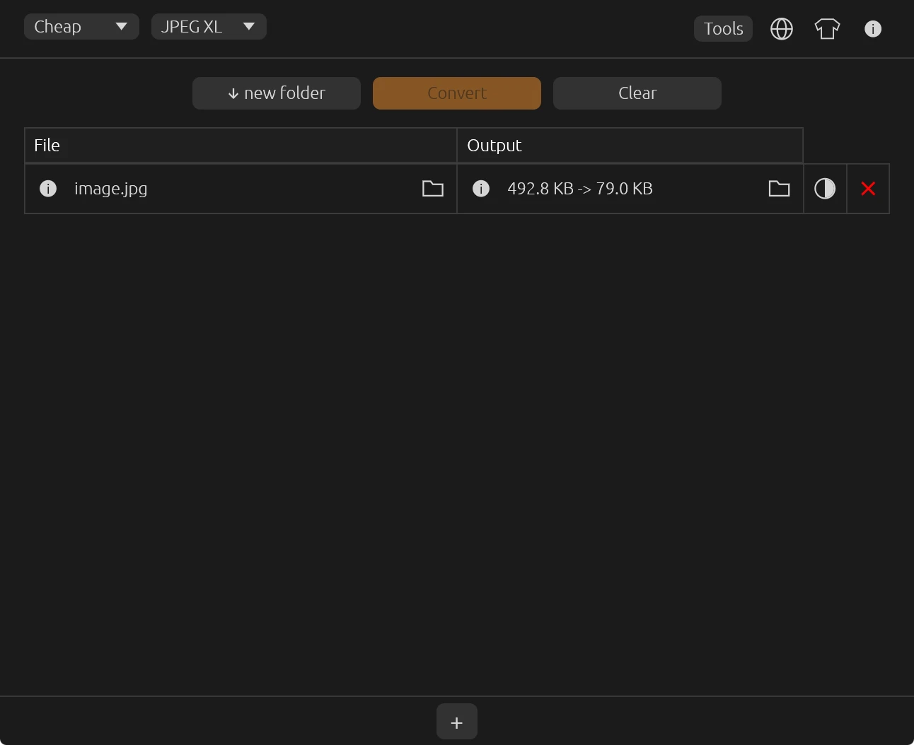

# Tenka

---

> [!NOTE]
> Development builds may contain bugs or change behavior between updates.

---

Tenka is a Linux desktop image converter for JPEG XL and WebP. It uses an egui interface on Wayland and X11 and a separate Rust library to choose compression settings based on file size and visual similarity.

<!--
Upload the screenshot to assets/screenshot.webp and uncomment the image.

-->

---

## Features

- Batch conversion of still 8-bit JPEG, PNG, and WebP images up to 36 megapixels. JPEG-to-JPEG XL conversion supports up to 80 megapixels.
- Best, Balance, and Cheap compression modes. Conversion preserves image dimensions.
- Folder imports preserve the folder name and relative directory structure in the output directory.
- Full-resolution comparison with linked zoom and pan for JPEG, PNG, WebP, and JPEG XL images up to 36 megapixels.
- Image details for both source files and results, including a preview, file properties, format mismatch warnings, and available EXIF metadata.
- English and Russian interface with system, light, and dark themes.

---

<h2>Controls &amp; Shortcuts</h2>

On Wayland, use **+** to import images. The main window also lets you import folders with **+**.

| Input | Action |
| --- | --- |
| Drop files or folders, or select **+** | Add source images to the conversion queue. A folder import includes supported images in its subfolders. |
| Format selector in the header | Choose JPEG XL or WebP. |
| Mode selector in the header | **Best** prioritizes similarity. **Balance** weighs similarity and proportional size savings. **Cheap** picks the smallest result that passes the perceptual and local detail checks. |
| Select **Output** | Choose the folder for converted images. |
| Select **Convert** | Start conversion. If **Output** is empty, the folder chooser opens in the directory of the first file still in the queue. Conversion starts after you choose a folder. Existing files are kept. |
| Select **Cancel** during conversion | Stop the batch. Select **Convert** to continue with the pending files. |
| Finish a conversion queue | See file counts, size savings, and time spent converting. Open the error panel or the common destination folder when available. |
| Select **Clear** | Remove all entries from the conversion queue and reset the output folder. |
| Select the red **!** in the footer | View conversion errors. Select an error to jump to its queue row, or select the share icon to copy all errors. |
| Select the red cross on a row | Remove that entry from the conversion queue. |
| Select the split circle on a completed row | Compare the original on the left with the converted image on the right. |
| Drag the divider between **File** and **Output** | Resize both columns. |
| Select a folder icon in **File** or **Output** | Open the containing folder with the original or converted file selected. The **Output** size context menu also reveals the converted file. |
| Select the information icon in **File** or **Output** | View the preview and file properties. Expand **EXIF data** to inspect the tags. |
| Double-click an image preview in its details | Open the file in the default image viewer. |
| Select **Tools → Compare** | Drop files into the comparison window or select **+**. Press **Mode** to switch between a shared split view and separate side-by-side images. Scroll to zoom at the pointer and drag with the left mouse button to pan together. |
| Select the globe | Toggle between the system language and English. |
| Select the T-shirt | Cycle through system appearance, light, and dark. The shirt shows an **A** in system mode. |
| Select the information icon in the header | Open About to see the installed version, project links, and components. **Check for updates** checks for a newer stable release on GitHub. |

Tenka looks for results smaller than the source and caps the output at the format's lossless size. If no smaller JPEG XL passes the selected mode's quality checks, Tenka saves the smallest acceptable candidate and flags any size increase. WebP conversion skips files without a smaller result. Above 36 megapixels, Best uses reversible JPEG-to-JPEG XL transcoding. Balance and Cheap also test lossy candidates.

The footer estimates the time remaining from the latest ten completed files, using input bytes and pixel counts when available.

---

## Installation & Usage

### Architecture & Format Support

| Format | x86_64 | arm64 |
| --- | --- | --- |
| AppImage | ✅ | ❌ |

### Release scheme

Stable versions follow `X.Y.0`. Versions `X.Y.Z` with `Z > 0` are automatic dependency prereleases. See the [latest stable release](https://github.com/yrmuq/tenka/releases/latest) or the [full release list](https://github.com/yrmuq/tenka/releases).

### AppImage

Download the x86_64 `.AppImage` from the [stable download page](https://github.com/yrmuq/tenka/releases/latest) or try an [AppImage development build](https://github.com/yrmuq/tenka/actions/workflows/dev.yml). AppImages built from this branch use Ubuntu 24.04 LTS and bundle the XKB libraries for X11. File dialogs use the Linux desktop portal.

[Gear Lever](https://flathub.org/apps/it.mijorus.gearlever) can install and integrate the stable AppImage and apply supported updates. Import the `.AppImage` in Gear Lever. The stable AppImage embeds update metadata, and its companion `.zsync` enables delta updates for compatible tools.

---

## License & Attribution

Tenka is distributed under the [GNU General Public License, version 3](LICENSE).

| Component | Upstream | License | Integration Details |
| --- | --- | --- | --- |
| egui / eframe | [emilk/egui](https://github.com/emilk/egui) | `MIT OR Apache-2.0` | Desktop interface. |
| Smithay Clipboard | [Smithay/smithay-clipboard](https://github.com/Smithay/smithay-clipboard) | `MIT` | Wayland clipboard. |
| jpegxl-rs | [inflation/jpegxl-rs](https://github.com/inflation/jpegxl-rs) | `GPL-3.0-or-later` | Rust bindings for JPEG XL. |
| libjxl | [libjxl/libjxl](https://github.com/libjxl/libjxl) | `BSD-3-Clause` | JPEG XL codec. |
| libwebp | [webmproject/libwebp](https://github.com/webmproject/libwebp) | `BSD-3-Clause` | WebP encoder for conversion and comparison. |
| kamadak-exif | [kamadak/exif-rs](https://github.com/kamadak/exif-rs) | `BSD-2-Clause` | EXIF metadata parsing. |
| SSIMULACRA2 | [rust-av/ssimulacra2](https://github.com/rust-av/ssimulacra2) | `BSD-2-Clause` | Perceptual quality metric. |
| ureq | [algesten/ureq](https://github.com/algesten/ureq) | `MIT OR Apache-2.0` | HTTPS checks for updates. |
